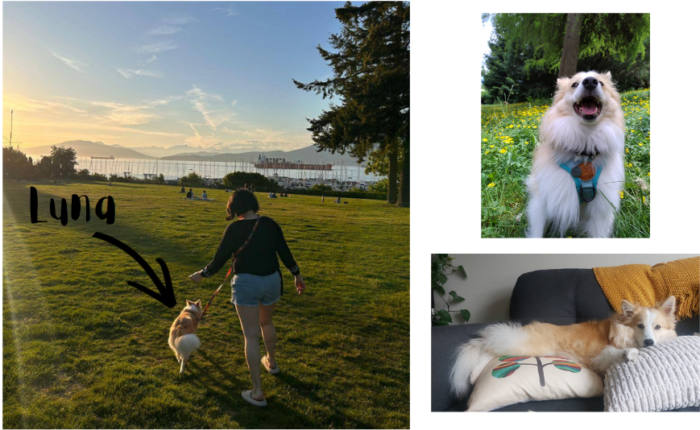

## Paola Arguello Pascualli

I analyse genomic data and focus on interpretation: what a result can support and what it can't. A lot of my work deals with genetic ancestry and with people who are underrepresented in genomic reference data, including Latin American populations.

**Education**

- MSc, Medical Genetics, University of British Columbia (2025)
- Honours BSc, Genomic Sciences, UNAM, Mexico (2019)

[Curriculum (PDF)](assets/Paola_Arguello_Pascualli_CV.pdf) 

**Research areas:** RNA-seq and ChIP-seq analysis, GWAS and polygenic risk scores, ancestry-aware analysis, Latin American and other underrepresented populations.

**Tools:** R (tidyverse, Shiny, DESeq2), Nextflow, Quarto, Git and GitHub, Unix shell.
<!-- TODO: add Python and bcftools once the variant pipeline repo is public. -->

**Teaching:** more than five years of teaching and tutoring, from grade 10 students to graduate students.

**Contact:** [paolaap@student.ubc.ca](mailto:paolaap@student.ubc.ca)

---

## The core of Lunaland

I am interested in how scientific knowledge is built, challenged, and sometimes misunderstood.
My work sits at the intersection of biology, statistics, and computation, but my curiosity extends beyond any single field.

The same principles that shape genomics also shape physics, economics, and even theology: we observe, we model, we interpret, and we make decisions under uncertainty.

History shows us that some of the most powerful ideas come from crossing boundaries. Einstein relied deeply on mathematics at a time when physics resisted it. Alan Turing, a mathematician, proposed a mechanism for biological pattern formation that was ignored for decades before becoming foundational.

These stories are not exceptions, they are reminders that knowledge advances when we allow ideas to move freely between disciplines.

At the same time, science is a human process. It carries bias, incentives, and limitations. Data can mislead, pipelines can break, and results can be overinterpreted.

My work focuses on making those weak points visible and turning them into opportunities for better reasoning, better tools, and clearer communication.

### Meet Luna

Also at the center of my work is Luna. She is the unofficial companion to all my projects, a patient listener during work rambles and a persistent reminder that the best thinking sometimes happens outside.

::: {.about-photo}

{fig-alt="About page photo"}

:::

## How I use AI tools

## How I use AI tools

I think of AI as a form of extended cognition. Some researchers argue that a web-weaving spider uses its web as part of how it thinks: it tunes the threads to pick up vibrations better and catch more prey. I see these models the same way. They take on part of the work so I can spend my attention on harder questions, and they make more ambitious projects possible. For me they also open a real path to doing independent research.

I know the common worry is that these tools will make people unnecessary, and that they take away originality, creativity and critical thinking. That concern is real. But if we only look at what AI can take from us, it gets harder to decide what role we want it to have. These tools are not going away. As Dewey from *Malcolm in the Middle* put it when he and his brothers finally beat their dad at basketball: "The future is now, old man." I think the best way to have a say in how they are used, in research and elsewhere, is to use them openly. If we are transparent about how we use them, we can learn together what caveats, rules and guidelines they need.

So here is how I use them. I use AI assistants, including Claude by Anthropic, while building this site and the code behind it. They help me draft and edit text, write and review code, and check for broken links and inconsistencies.

I decide what goes on the site and I review every change before it is published. The analyses, interpretations and any mistakes are mine. Results come from code in the linked repositories, and anything based on simulated data is labelled as simulated.

## Links

- [GitHub](https://github.com/paola-arguello)
- [LinkedIn](https://www.linkedin.com/in/paola-arguello-pascualli-216b82349)