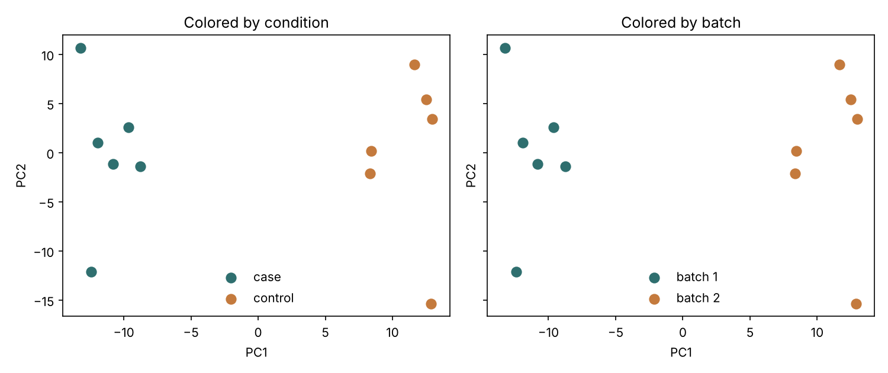

## The mistake

Treating technical structure in the data as biological signal.

The classic version: samples cluster cleanly, groups separate nicely, and the result looks convincing.  
But the separation is driven by **when, where or how the samples were processed**, not by biology.

## Why it happens

Most datasets are not generated under perfectly controlled conditions.

Common sources:

- samples processed on different days
- sequencing runs split across lanes
- library prep done in batches
- different technicians or centers
- case and control groups handled at different times

The critical failure is not the presence of batch effects.  
It is when **batch and biological condition overlap**.

At that point, the data cannot tell you which is which.

## What breaks

Batch effects don’t just add noise. They add **structure**.

That structure can:

- create artificial separation between groups
- inflate differential expression results
- hide real biological signal
- make models look more confident than they should be

The dangerous part is that everything can look “clean”:

- PCA plots show tight clusters  
- volcano plots show strong hits  
- models converge without warnings  

But the interpretation is wrong.

## How to detect it

This usually shows up during exploratory analysis.

Things that have saved me more than once:

- PCA colored by **both condition and batch**
- checking whether samples cluster by sequencing date instead of phenotype
- looking at metadata early, not after modeling
- counting how many batches exist per group

A simple but critical question:

> If I remove the condition labels, would I still see the same clusters?

If yes, something else is driving the structure.

## How to prevent it

Some problems are fixable. Some are not.

Good habits:

- record batch variables in metadata (date, lane, center, prep)
- balance cases and controls across batches when possible
- check for confounding before modeling
- include batch terms in the model *only when design allows it*
- document limitations when batch and condition are inseparable

The uncomfortable truth:

> If batch and condition are perfectly confounded, no statistical method can fully recover the biology.

At that point, interpretation needs to be cautious, not clever.

## Tiny demo

A minimal example of how misleading structure can look:

| sample | condition | batch | PC1 (sketch) |
|---|---|---|---|
| S1 | case | batch1 | -5 |
| S2 | case | batch1 | -4 |
| S3 | control | batch2 | 4 |
| S4 | control | batch2 | 5 |

If you color by condition:

- cases cluster together  
- controls cluster together  

Looks biological.

If you color by batch:

- batch1 vs batch2 separation is identical  

The plot did not lie.  
It just answered a different question.

## The same plot, colored two ways

{fig-alt="Two PCA scatter plots of the same 12 simulated samples. Left panel colored by case and control, right panel colored by batch 1 and batch 2. The two groups separate the same way in both panels."}

The same structure can support two different stories depending on what you color by.

The data here are simulated. All cases were processed in batch 1 and all controls in batch 2. The expression values contain a batch shift and no condition effect at all, so the clean separation on the left is entirely technical. The script that makes this figure is `scripts/batch_effects_pca.py` in the site repository.

## Related project

[RNA-seq Workflow Demo](../projects/rnaseq-workflow.qmd)

Relevant workflow section:

**Statistical analysis → interpretation**

This is where patterns are interpreted and where batch effects can silently turn technical variation into biological claims.

## Related Crosswalk post

Coming soon: **When patterns are not biology: the illusion of clean data**

## Related Concept Atlas entries

- Batch effect  
- Confounding  
- PCA  
- Experimental design  
- Differential expression  
- Biological interpretation  