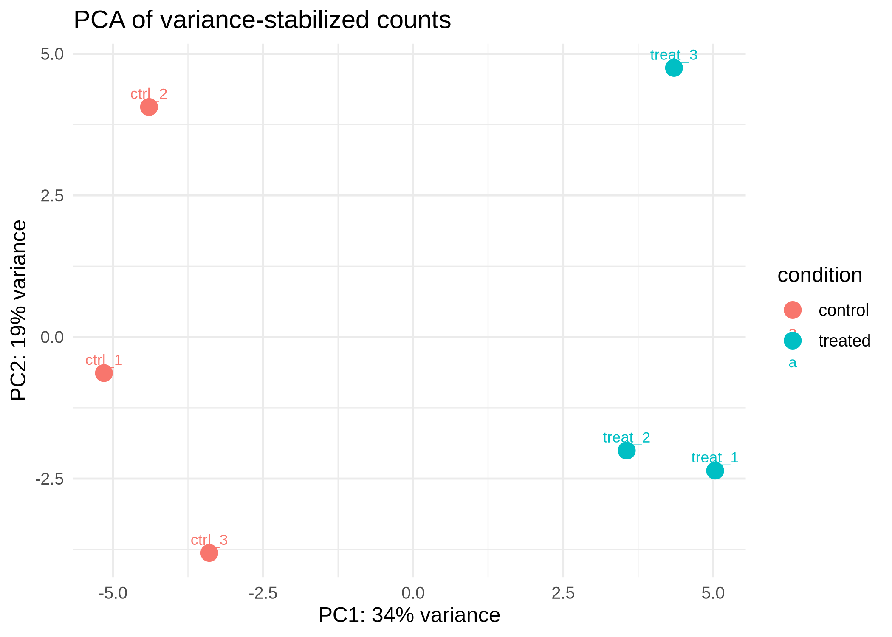
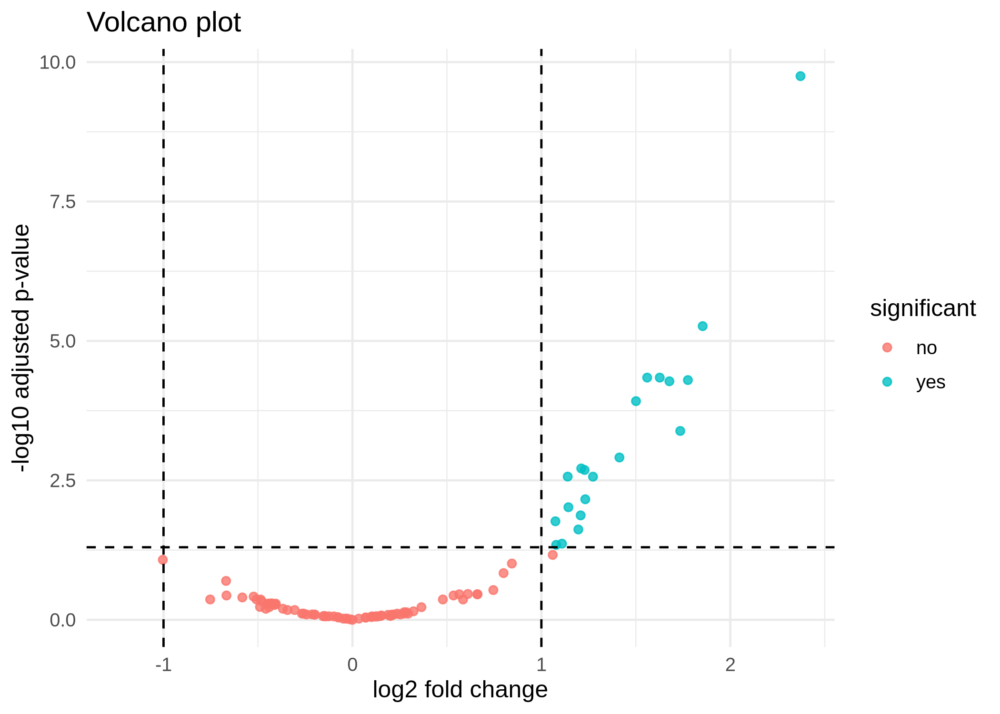

**Tools:** Nextflow (DSL2), FastQC, Trimmomatic, STAR, featureCounts, MultiQC, R, DESeq2, ggplot2, conda  
**Code:** [github.com/paola-arguello/rna-seq-demo](https://github.com/paola-arguello/rna-seq-demo)  

## Opening

Scientific data is messy.

Before we interpret results, data moves through multiple steps. Each one makes assumptions, adds structure and can create patterns nobody intended.

This project shows how RNA-seq data moves through that process, and where interpretation can become uncertain.

---

## The Question

Why does analyzing RNA-seq data require more than just running a pipeline?

---

## Workflow Overview

RNA-seq analysis is often presented as a sequence of steps:

Raw data → quality control → processing → statistical analysis → interpretation

In practice, each of these steps transforms the data.

- Quality control decides what data is considered usable
- Alignment maps reads to a reference that may not perfectly represent the sample
- Quantification reduces complex read data into gene-level summaries
- Statistical analysis highlights patterns under specific assumptions

At each step, information is filtered, reshaped and interpreted.

The final results depend not only on the data itself, but on how these transformations are applied.

---

## What I Built

The project has two parts, and they are at different stages.

**Preprocessing (written, not yet run on reads).** A Nextflow DSL2 workflow with one module per step: FastQC, Trimmomatic, STAR alignment, featureCounts and MultiQC. Parameters live in `params.yaml` and the software environment in `environment.yml`. I have not run it on real FASTQ files yet.

**Differential expression (run).** An R script simulates a count matrix, and a second script analyses it with DESeq2 and makes the figures below. The simulation has 300 genes and 3 control and 3 treated samples. I raised the mean of 25 genes by 2.5 times in the treated samples, so I know which genes should come out as differentially expressed.

The goal is not a production-ready pipeline. It is to show how analysis decisions are structured, and how they affect interpretation.

---

## Outputs

All results below come from simulated counts, not a real experiment.

### PCA plot

A PCA plot summarizes variation across samples.

It can reveal clustering patterns, potential batch effects or outliers.

It does not explain *why* samples cluster, only that they do. Here the samples separate by condition on PC1, which is the treatment effect I simulated.

---

### Volcano plot

A volcano plot highlights genes with large changes and strong statistical signals.

It helps prioritize candidates for further investigation.

It does not confirm biological relevance.

All the significant genes point up because the simulation only increased expression. A real experiment would usually have genes going both ways.

---

### Results table (top 3 genes)

| Gene | log2 fold change | p-value | Adjusted p-value |
|------|------------------|---------|------------------|
| gene_3 | 2.37 | 1.8 × 10^-12^ | 1.8 × 10^-10^ |
| gene_23 | 1.85 | 1.1 × 10^-7^ | 5.4 × 10^-6^ |
| gene_5 | 1.56 | 1.5 × 10^-6^ | 4.5 × 10^-5^ |

The full table is in the repository (`results/deseq2/deseq2_results.csv`).

Because the simulation tells me which genes really changed, I can check the result. DESeq2 called 20 genes significant (adjusted p < 0.05). All 20 are among the 25 I simulated as changed, so there were no false positives. It missed 5. In those genes the random draws happened to give a small observed change (log2 fold change between 0.27 and 1.06), and with 3 samples per group that is not enough to pass the threshold.

---

## Interpretation

Differential expression analysis identifies genes whose expression levels differ between conditions.

This is a statistical statement, not a biological conclusion.

A gene can appear statistically significant because:

- the effect size is large
- the variability is low
- the sample size is sufficient

But statistical significance does not guarantee biological importance.

Effect size, variability and context all matter. The 5 missed genes show the other side: a real change can go undetected when the sample is small.

Patterns in data do not automatically turn into biological insight. They need interpretation.

---

## Where Things Go Wrong

Some errors are invisible at first glance.

A [Wrong Genome Build](../pitfalls/wrong-genome-build.qmd) can shift coordinates so that reads map to the wrong locations, producing results that look valid but refer to the wrong biology.

[Batch Effects](../pitfalls/batch-effects.qmd) can introduce systematic differences between groups that are unrelated to the biological condition, creating patterns that appear meaningful but are driven by technical structure.

Filtering also changes what gets tested. In this run, DESeq2's independent filtering gave no adjusted p-value to 198 of the 300 genes, all with mean counts below about 96. None of the 25 changed genes was filtered out here, but in real data a filtered gene is easy to mistake for a gene that showed no change.

---

## Connecting to Statistical Reasoning

These challenges are not unique to RNA-seq.

They reflect broader questions about uncertainty, sample size and interpretation.

See: [When is a genetic association real?](../crosswalk/posts/genetic-association-real.qmd)

Statistical results depend on how much data we have, how variable it is and how we model it.

Understanding those limits is part of interpreting any result.

---

## Key Concepts

- **Batch effect:** differences driven by experimental conditions rather than biology
- **Sample metadata:** information about how samples were collected and processed
- **PCA:** a way to summarize variation across samples
- **Differential expression:** statistical comparison of gene expression between groups
- **Normalization:** adjusting counts to make samples comparable

---

## Limitations

- The preprocessing workflow has not been run on real reads yet.
- The counts are simulated, with only upregulated genes and no batch structure.
- It is not a clinical-grade pipeline.

Next step: run the preprocessing on a small public dataset so both parts are connected.

---

## Closing

Understanding data is not just about building pipelines. It is about knowing where results come from, what assumptions they carry and how easily they can mislead.
